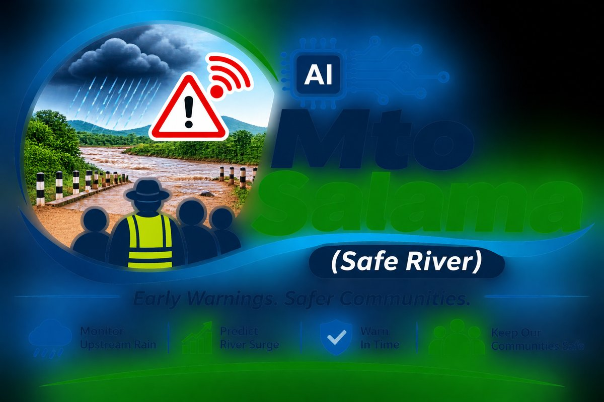
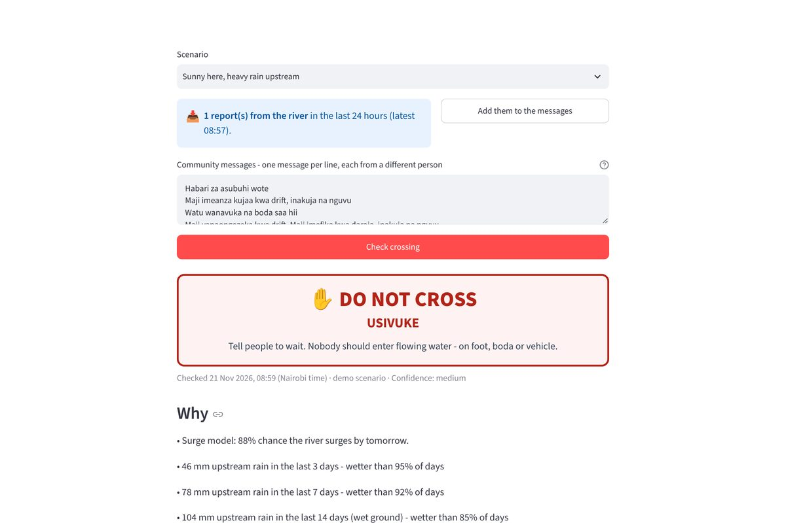
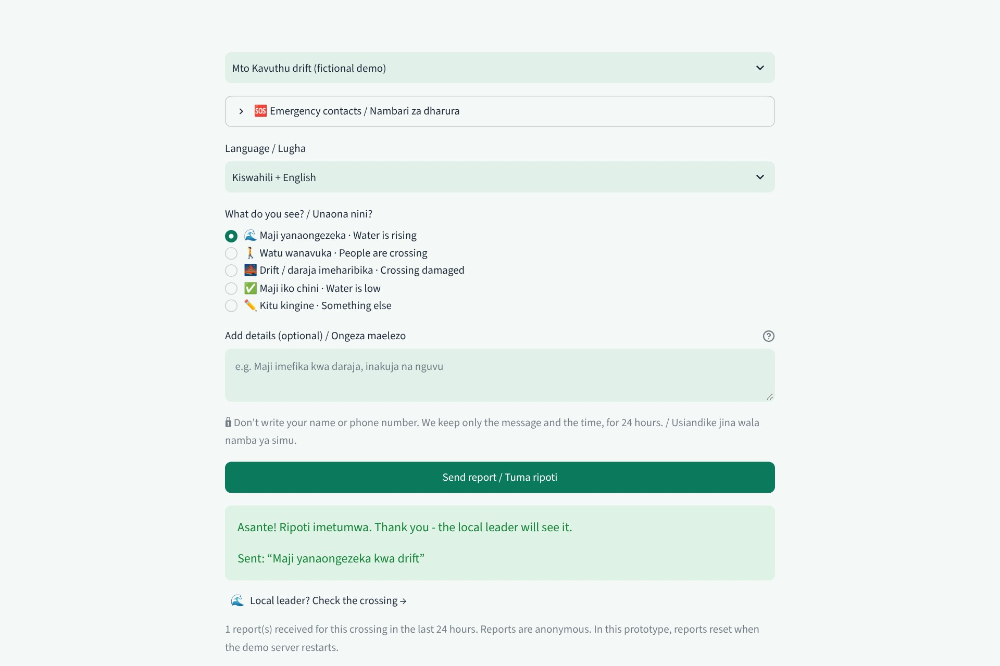
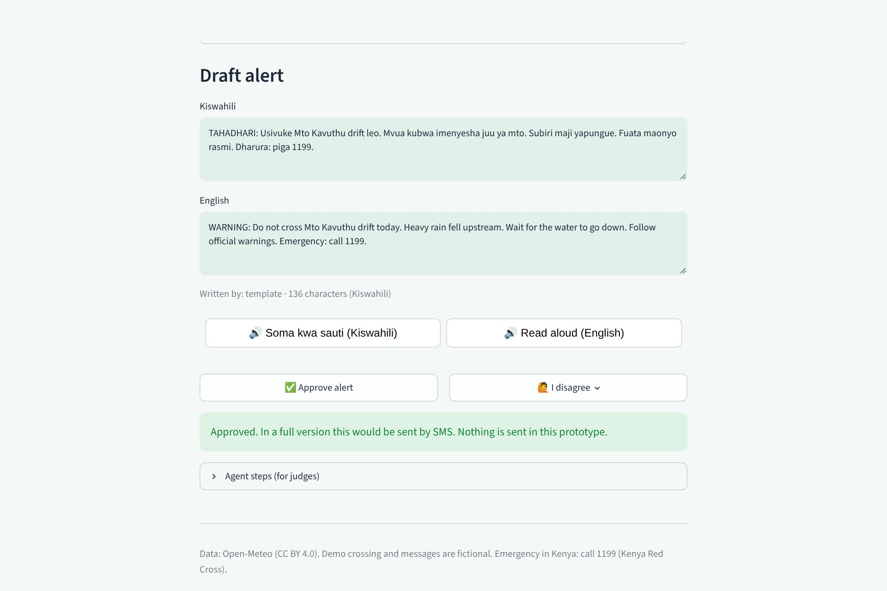
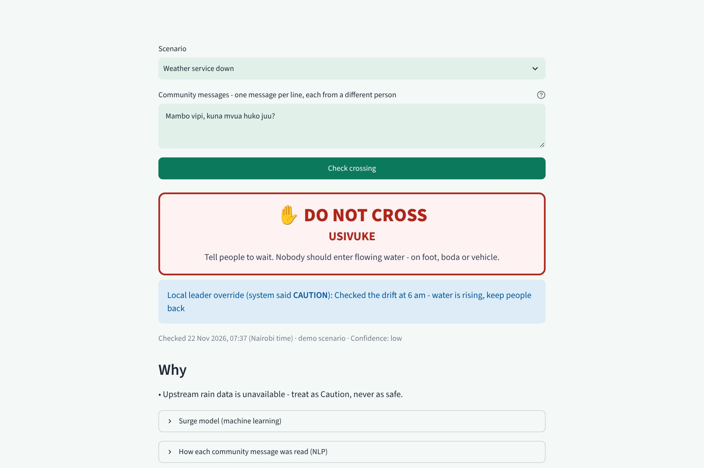
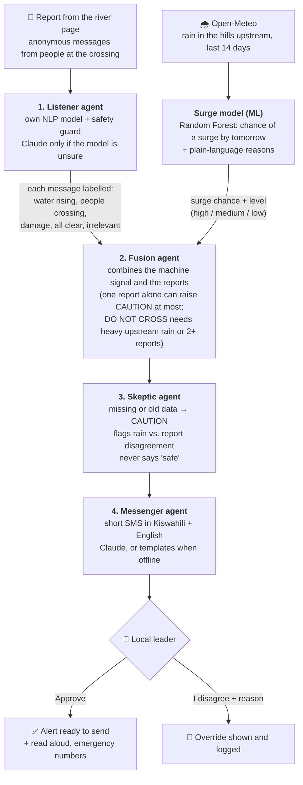

# Mto Salama (Safe River)

Multi-agent AI that warns local leaders when **rain upstream** makes a seasonal river
crossing dangerous - even when it is dry and sunny at the crossing.

**Live demo:** https://mto-salama.streamlit.app (if it says the app is asleep, click to wake it and wait about a minute)

> Prototype for SafeSpace Hacks 2026. It supports official warnings; it does not replace
> the Kenya Meteorological Department, county authorities or emergency services (999 / 1199).

**Built by:** Meshack Mutinda, Open University of Kenya (solo entry), during SafeSpace Hacks
(17 Oct - 22 Nov 2026). See [DEVLOG.md](DEVLOG.md) and the commit history.



## The problem

Every rainy season in Kenya, people drown at seasonal river crossings ("drifts"). It is often
dry and sunny where they stand - the rain fell hours earlier in the hills upstream, and the surge
arrives without warning. In April 2024, nine people died when a truck crossing the swollen
Kwa Muswii River in Makueni County was swept away. Today's warnings are regional ("flash floods
possible in parts of the region"); nobody tells a village *"don't cross your drift today"*.

**Who it helps:** a local leader - chief, community health volunteer, school head - deciding
whether people can cross this morning.

**Safer outcome:** before anyone crosses, the local leader knows whether upstream rain makes
this crossing dangerous today, and why.

## Try it in one minute

Open https://mto-salama.streamlit.app, then:

1. **Sunny here, heavy rain upstream** -> *Check crossing* -> **DO NOT CROSS**, 88% surge chance, with reasons.
2. **Little rain, but villagers see rising water** -> still **DO NOT CROSS**, low confidence; the app explains the disagreement.
3. **Weather service down** -> **CAUTION** - with no data it never says "safe".
4. Open **Report from the river**, send "Water is rising", go back and press *Add them to the messages*.
5. Try **I disagree** (override with a reason), the **read-aloud** buttons and **Emergency contacts**.

| Report from the river | Bilingual alert, read aloud | Leader override |
|---|---|---|
|  |  |  |

## Results

| Part | How it was tested | Result |
|---|---|---|
| Surge model (Random Forest) | Trained 2000-2014, thresholds on 2015-2018, scored on **2019-2025 (unseen years)**, Nyando + Athi rivers | ROC AUC **0.84**; at CAUTION it catches **78%** of surges (about 1 in 4 calm days also gets CAUTION) |
| Listener (NLP) | Repeated 5-fold cross-validation on 260 synthetic Kiswahili/Sheng/English messages | **~80%** accuracy with the safety guard; "water rising" read as "all clear" cut from **22% to 12%** |
| Whole app | Normal, confusing and failure scenarios | DO NOT CROSS, DO NOT CROSS (low confidence), CAUTION - as intended |

Full reports: [models/report.md](models/report.md), [models/listener_report.md](models/listener_report.md).

## How the agents work together



**How the coordination works in code** (`agents.jac`): each check builds a small graph - one
`Crossing` node linked to one `Report` node per message - and a `RiskCheck` walker travels it.
At the crossing it runs the Listener on every report, hands the labels and the surge model's
result to Fusion, passes Fusion's assessment to the Skeptic, and gives the checked assessment
to the Messenger. Every step is written to a trace that the app shows under "Agent steps".

| Step | Agent | Type | Why this type |
|---|---|---|---|
| 1 | Listener | Own NLP model + safety guard + Kikamba word list (beta); Claude only when unsure | Free and offline for most messages; AI only for hard ones |
| - | Surge model | Machine learning (Random Forest) | Learns the rain-to-surge pattern from 26 years of river data |
| 2 | Fusion | Rules (code) | Safety decisions must be predictable and explainable |
| 3 | Skeptic | Rules (code) | Checks the others; works even when AI is offline |
| 4 | Messenger | Claude (byLLM) or templates | Friendly wording; a template if AI is unavailable |
| 5 | Local leader | Human | A person approves or overrules every alert |

## Trust, safety and privacy

- **Explains every warning:** surge chance, how unusual the rain is, how each message was read.
- **Never says "safe":** the best status is "LOOKS CALM - CHECK THE WATER"; missing or old data gives CAUTION.
- **A human decides:** the leader approves or overrules every alert (with a reason, logged). Nothing is sent automatically.
- **Works when things fail:** own offline NLP model and templates if no AI service; simple rain rules if no model.
- **Minimal data:** no names, phone numbers or locations of people; phone numbers typed into reports are removed; reports kept 24 hours. All demo data is synthetic.
- **Accessible:** Kiswahili and English, status in words (not colour alone), read-aloud, screen-reader alert, phone-friendly, emergency numbers on every page.

## Run it (Python 3.12)

```
python -m venv .venv
.venv\Scripts\activate          # Windows  (Mac/Linux: source .venv/bin/activate)
pip install -r requirements.txt
streamlit run app.py        # the app in your browser
jac run agents.jac          # the agents in the terminal
```

No API key is needed: without one, the app runs in offline mode (own NLP model and alert
templates). To use Claude, copy `.env.example` to `.env`, add your Anthropic API key and set
`MTO_MODEL=anthropic/claude-haiku-5-5`.

## Train the surge model

```
python -m ml.download_history   # 26 years of rain + river flow (Open-Meteo / GloFAS)
python -m ml.train              # trains, tests on unseen years, writes models/report.md
```

Without a trained model the app falls back to simple rain rules.

## Train the Listener (NLP)

```
python -m nlp.train_listener    # 260 synthetic Kiswahili/Sheng/English messages
```

Add your own example messages to `data/messages.csv` and re-run to improve it.
Results: `models/listener_report.md`.

## Files

- `agents.jac` - the four-agent pipeline (Jac language, graph + walker)
- `app.py` - entry point with two pages:
  - `leader.py` - "Check a crossing" (local leader)
  - `report.py` - "Report from the river" (anyone at the crossing)
- `reports_store.py` - anonymous river reports, kept 24 hours
- `weather.py` - live upstream rainfall (Open-Meteo)
- `ml/` - surge predictor: features, history download, training, prediction
- `nlp/` - offline Listener: training, prediction, safety guard
- `data/messages*.csv` - synthetic community messages (no real people's data)
- `crossings.json` - the fictional demo crossing and its upstream points
- `contacts.py` - emergency numbers shown in the app
- `assets/logo.jpg` - project logo
- `check_data.py`, `check_ai.py` - setup checks

## Limitations

- The surge model catches about 4 in 5 surges on unseen years - it supports judgement, it does not replace it.
- River flow is modelled (GloFAS, about 5 km), not measured, and cannot see small streams directly;
  live upstream rain and people's reports carry the decision at small crossings.
- The NLP model learned from synthetic messages; it needs real, consented messages before field use.
- Alerts are drafted, not sent; reports reset when the free demo server restarts.

## Kikamba (beta)

Makueni is a Kamba-speaking county, so the Listener also recognises key Kikamba reports, using words
from published sources (Peace Corps Kikamba manual, Lugha Yangu Kamba dictionary, Bantu lexicon E55) -
for example *usi* (river), *kĩw'ũ* (water), *mbua* (rain), *kĩao* (bridge), *kũĩnga* (to cross) and the
sentence *"usi wausia kiwu ndukilika"* ("it's impossible to cross a river when it overflows").
It only reads Kikamba; alerts stay in Kiswahili and English until a native speaker checks Kikamba
wording. The rules have no effect on the 260 Kiswahili/Sheng/English test messages. See `nlp/kikamba.py`.

## What's next

Test with a chief or community health volunteer at a real Makueni crossing; retrain the NLP model
on real messages; Kikamba alerts checked by native speakers; send approved alerts by SMS; work with county disaster teams.

See `CREDITS.md` for data, tools and AI assistance.
