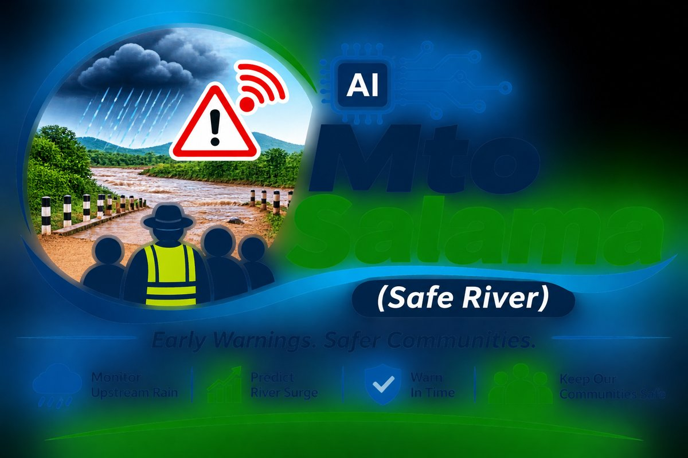
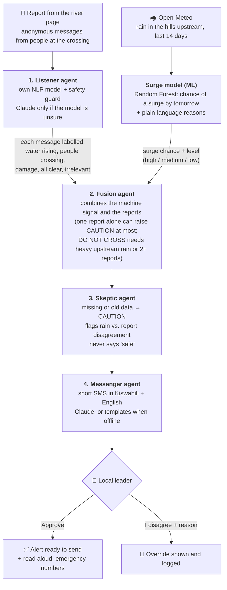

# Mto Salama (Safe River)

Multi-agent AI that warns local leaders when **rain upstream** makes a seasonal river
crossing dangerous - even when it is dry and sunny at the crossing.

**Live demo:** https://mto-salama.streamlit.app (if it says the app is asleep, click to wake it and wait about a minute)

> Prototype for SafeSpace Hacks 2026. It supports official warnings; it does not replace
> the Kenya Meteorological Department, county authorities or emergency services (999 / 1199).

## How the agents work together



**How the coordination works in code** (`agents.jac`): each check builds a small graph - one
`Crossing` node linked to one `Report` node per message - and a `RiskCheck` walker travels it.
At the crossing it runs the Listener on every report, hands the labels and the surge model's
result to Fusion, passes Fusion's assessment to the Skeptic, and gives the checked assessment
to the Messenger. Every step is written to a trace that the app shows under "Agent steps".

| Step | Agent | Type | Why this type |
|---|---|---|---|
| 1 | Listener | Own NLP model + safety guard; Claude only when unsure | Free and offline for most messages; AI only for hard ones |
| - | Surge model | Machine learning (Random Forest) | Learns the rain-to-surge pattern from 26 years of river data |
| 2 | Fusion | Rules (code) | Safety decisions must be predictable and explainable |
| 3 | Skeptic | Rules (code) | Checks the others; works even when AI is offline |
| 4 | Messenger | Claude (byLLM) or templates | Friendly wording; a template if AI is unavailable |
| 5 | Local leader | Human | A person approves or overrules every alert |

## Run it (Windows, VS Code terminal, Python 3.12)

```
python -m venv .venv
.venv\Scripts\activate
pip install -r requirements.txt
streamlit run app.py        # the app in your browser
jac run agents.jac          # the agents in the terminal
```

No API key is needed: without one, the app runs in offline mode (own NLP model and alert
templates). To use Claude, copy `.env.example` to `.env`, add your Anthropic API key and set
`MTO_MODEL=anthropic/claude-haiku-5-5`.

## Train the surge model

```
python -m ml.download_history   # 26 years of rain + river flow (Open-Meteo / GloFAS)
python -m ml.train              # trains, tests on unseen years, writes models/report.md
```

Without a trained model the app falls back to simple rain rules.

## Train the Listener (NLP)

```
python -m nlp.train_listener    # 260 synthetic Kiswahili/Sheng/English messages
```

Add your own example messages to `data/messages.csv` and re-run to improve it.
Results: `models/listener_report.md`.

## Files

- `agents.jac` - the four-agent pipeline (Jac language, graph + walker)
- `app.py` - entry point with two pages:
  - `leader.py` - "Check a crossing" (local leader)
  - `report.py` - "Report from the river" (anyone at the crossing)
- `reports_store.py` - anonymous river reports, kept 24 hours
- `weather.py` - live upstream rainfall (Open-Meteo)
- `ml/` - surge predictor: features, history download, training, prediction
- `nlp/` - offline Listener: training, prediction, safety guard
- `data/messages*.csv` - synthetic community messages (no real people's data)
- `crossings.json` - the fictional demo crossing and its upstream points
- `contacts.py` - emergency numbers shown in the app
- `assets/logo.jpg` - project logo
- `check_data.py`, `check_ai.py` - setup checks

## Limitations

Rainfall and river models are coarse (about 5 km for river flow) and can miss small
seasonal streams. Community reports help fill that gap, but the tool can be wrong -
people should always look at the water and follow official warnings.

See `CREDITS.md` for data, tools and AI assistance.
